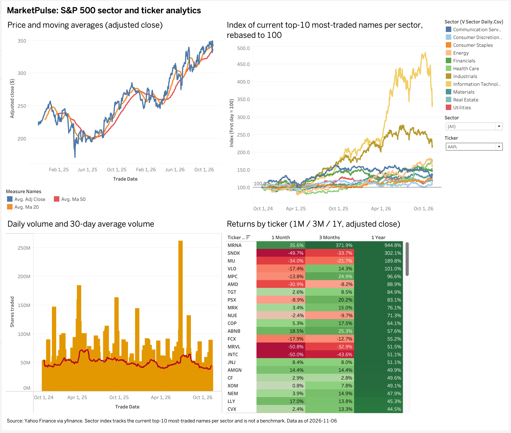
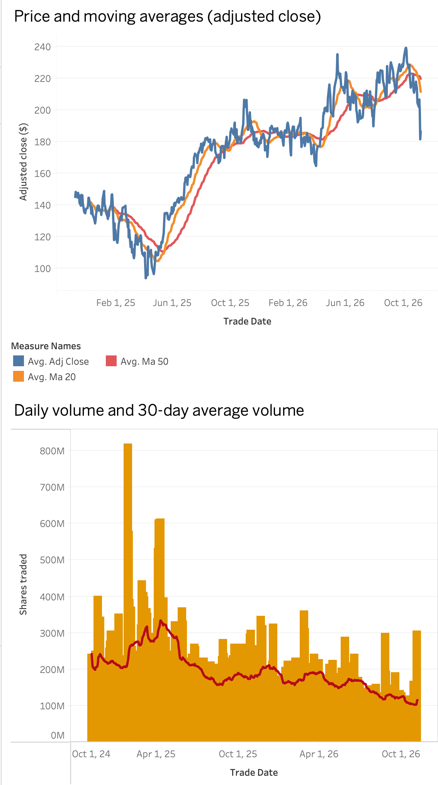
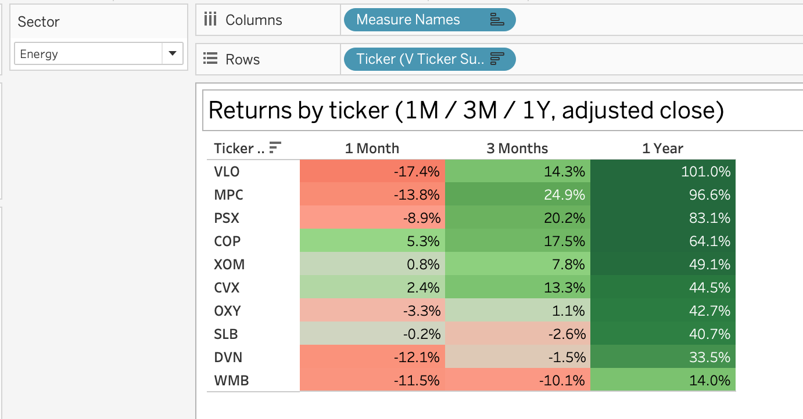

# MarketPulse

A daily market data pipeline for 110 S&P 500 tickers: Python and Pandas ETL from Yahoo
Finance into PostgreSQL, with automated data quality checks, reconciliation, and a
Tableau dashboard on top.

## Overview

MarketPulse pulls daily OHLCV prices, loads them into PostgreSQL with idempotent upserts,
checks every load for data quality problems, reconciles the stored data against a fresh
pull, and records every run, check and reconciliation in database tables. Reporting
views feed a Tableau dashboard.

- **Stack:** Python 3.12, Pandas, SQL, PostgreSQL 16, Tableau. Libraries: SQLAlchemy 2,
  psycopg 3, yfinance, python-dotenv, pytest.
- **Data source:** Yahoo Finance, via [yfinance](https://github.com/ranaroussi/yfinance).
- **Universe:** the 10 most-traded S&P 500 tickers in each of the 11 GICS sectors, by
  average daily dollar volume over 3 months. `seeds/tickers.csv` is a frozen snapshot
  taken on 2026-11-06.

## Architecture

```
            seeds/tickers.csv ──> dim_security
                                       │ tickers
                                       v
  Yahoo Finance ──> extract ──> transform ──> load ──> fact_daily_price
   (yfinance)      batches of   flatten,     upsert on        │
                   25, retries  types, sort  (ticker, date)   v
                                                         DQ checks ──> dq_check_result
                                                              │
                                                              v
                                    fresh pull ──>   reconciliation ──> reconciliation_result
                                                              │
                         every run ──> etl_run_log            v
                                                     SQL views ──> CSV export ──> Tableau
```

- **Idempotent loads:** prices are upserted on `(ticker, trade_date)`, so any run is
  safe to repeat. A row only counts as updated when a value really changed. Tiny
  `adj_close` differences between identical Yahoo pulls are ignored below a relative
  tolerance.
- **7-day catch-up window:** the daily run re-fetches the last 7 calendar days, so
  missed days fill in automatically and revisions to recent days are picked up.
- **Weekly full refresh:** `--refresh-history` re-fetches 2 years, which picks up
  dividend and split adjustments to older history.
- **DQ checks:** null prices, non-positive prices, high below low, open or close outside
  the day's range, negative or null volume, missing trading days, and stale tickers. A
  failed check is recorded and never blocks or changes data.
- **Reconciliation:** close, adj_close and volume are compared with a fresh pull of the
  same window, within named tolerances. Rows found on only one side count as mismatches.
- **Scheduling:** launchd runs the daily job Monday to Friday at 18:30 local time, and
  the weekly refresh on Saturday at 10:00. Both share one lock, so runs never overlap.
  Each run records whether launchd or a person started it.

## Results

<!-- results:start -->
**30-day window in progress:**

Generated with `python -m etl.report --days 30`. Every figure below comes
from etl_run_log, dq_check_result, reconciliation_result and
fact_daily_price.

```
MarketPulse report, last 30 days (generated 2026-11-07 21:25 ET)

30-day window in progress: 0 days complete
Scheduled runs: first none, last none, failed 0

Runs by trigger and status:
  manual success: 7

Rows in fact_daily_price: 55154
Distinct tickers: 110
Trade dates: 2024-11-06 to 2026-11-06

DQ check results: 42 across 6 runs, 0 failed
Failed DQ checks:
  none

Reconciliations: 6
Reconciliation coverage: 1 days
Average discrepancy: 0.0000%
Maximum discrepancy: 0.0000%
```
<!-- results:end -->

## Dashboard

Screenshots of the Tableau dashboard, built on the CSV export.

**Sector performance**, in the full dashboard: the index of the current top-10
most-traded names per sector, with price, volume and returns panels.



**Price trend and volume:** adjusted close with 20- and 50-day moving averages, and daily
volume with its 30-day average.



**Returns heatmap:** 1-month, 3-month and 1-year returns by ticker, from adjusted close.



## Honest framing

- **Reconciliation checks load fidelity, not the data's accuracy.** It compares what was
  stored with a fresh pull from the same source, Yahoo Finance. It catches load bugs and
  later revisions by Yahoo, but it cannot catch an error in Yahoo's own data. It is not
  independent validation.
- **The sector index is not a benchmark.** It tracks the current top-10 most-traded names
  in each sector, chosen by recent trading activity and then tracked back through
  history. That selection favours names that grew and became active by the end of the
  period, so it reflects how today's most-traded names performed, not the sector. It is
  equal-weighted and rebased to 100 on the first date, so a single stock can move it
  sharply.
- **110 tickers are 109 companies.** Alphabet appears twice, as GOOGL (Class A) and GOOG
  (Class C), and counts twice in Communication Services.

## Data and licensing

- Prices come from Yahoo Finance through yfinance. yfinance is not affiliated with
  Yahoo, and its documentation notes that the Yahoo Finance API is intended for personal
  use only. Check Yahoo's terms before you reuse or publish the data.
- This repository contains no price data files: `data/` is gitignored, and there is no
  Tableau workbook with embedded data. The screenshots are images of charts only.
- `seeds/tickers.csv` lists tickers, company names and GICS classifications derived from
  Wikipedia's
  [List of S&P 500 companies](https://en.wikipedia.org/wiki/List_of_S%26P_500_companies)
  (CC BY-SA).
- Run the ETL to pull your own data.

## How to run

**Requirements:** macOS, Python 3.12, PostgreSQL 16 (for example
`brew install postgresql@16` and `brew services start postgresql@16`).

1. **Set up the environment and database.**

   ```sh
   python3.12 -m venv .venv
   .venv/bin/pip install -r requirements.txt
   createdb marketpulse
   ```

2. **Create `.env`** in the repo root. It is gitignored; never commit it.

   ```
   DATABASE_URL=postgresql+psycopg://<user>@localhost:5432/marketpulse
   ```

3. **Apply the schema and views, then load the tickers.**

   ```sh
   .venv/bin/python -m etl.db
   .venv/bin/python -m etl.load
   ```

4. **Backfill 2 years of history.**

   ```sh
   .venv/bin/python -m etl.run_daily --backfill-years 2
   ```

5. **Run the daily and weekly jobs by hand**, or schedule them with launchd.

   ```sh
   .venv/bin/python -m etl.run_daily                    # daily: 7-day catch-up
   .venv/bin/python -m etl.run_daily --refresh-history  # weekly: 2-year refresh
   scripts/install_launchd.sh                           # schedule both
   scripts/uninstall_launchd.sh                         # remove the schedule
   ```

   The plists in `launchd/` use absolute paths. Update them if the repo is somewhere
   else. Logs go to `logs/daily.log`, `logs/weekly.log`, `logs/etl.log` and
   `logs/launchd.*.log`. A Mac asleep at the scheduled time runs the job when it wakes.
   A Mac that is powered off skips it, and the 7-day catch-up window covers the gap.

6. **Run the tests.** Some tests read the real data, so run them after the backfill.
   Test rows use fake tickers and are removed afterwards.

   ```sh
   .venv/bin/pytest -q
   ```

7. **Report and export.**

   ```sh
   .venv/bin/python -m etl.report --days 30          # pipeline health
   .venv/bin/python -m etl.export_tableau            # CSVs to data/tableau/
   .venv/bin/python scripts/update_readme_results.py # refresh the Results section
   ```

   Tableau Public cannot connect to PostgreSQL, so the dashboard uses the CSVs in
   `data/tableau/`. The export also writes a README explaining the sector index.
